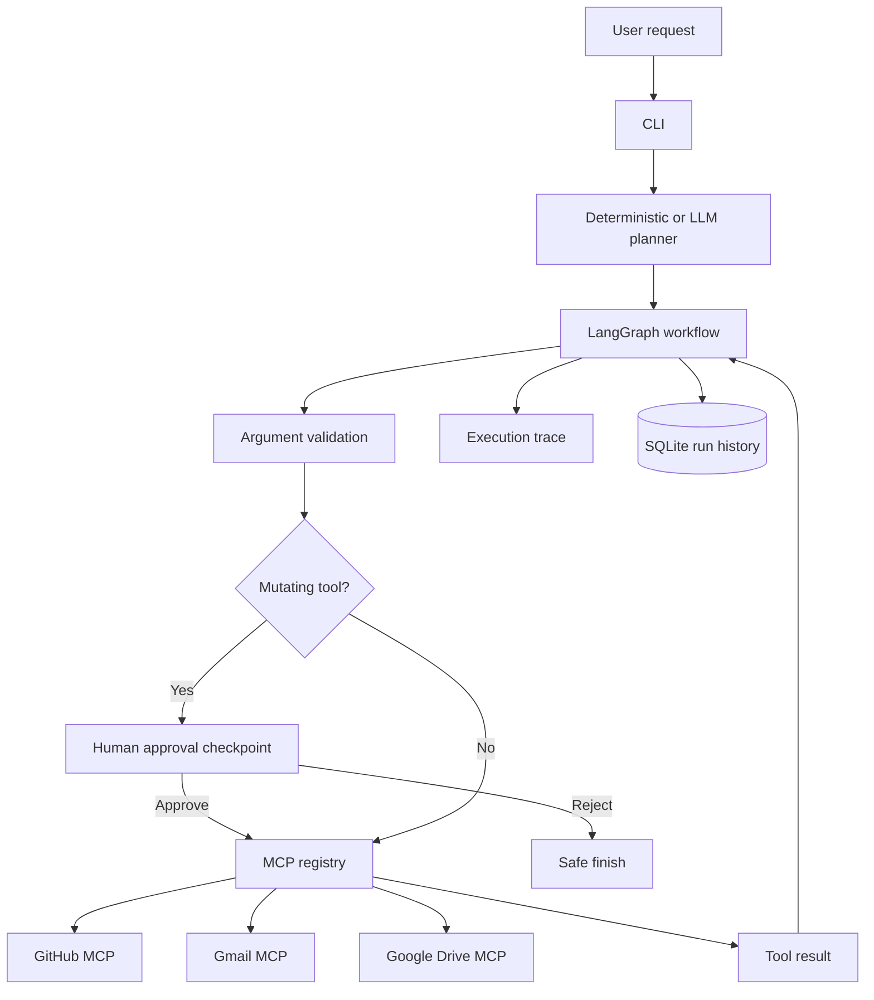

# Architecture

The agent uses one LangGraph workflow to plan and execute tasks through three
namespaced MCP servers. Each server can be a local mock for development or a
real external connection for GitHub, Gmail, and Google Drive.

## Connection model

- GitHub runs through the official Docker MCP server using GitHub CLI
  authentication.
- Gmail and Google Drive use Google-hosted MCP endpoints through the
  `mcp-remote` stdio wrapper and OAuth 2.0.
- Local mock servers expose compatible tool names for offline tests.

## Safety model

Read-only tools execute immediately. Mutating tools, such as creating a Gmail
draft or Drive file, pause the graph and persist a resumable approval state.
